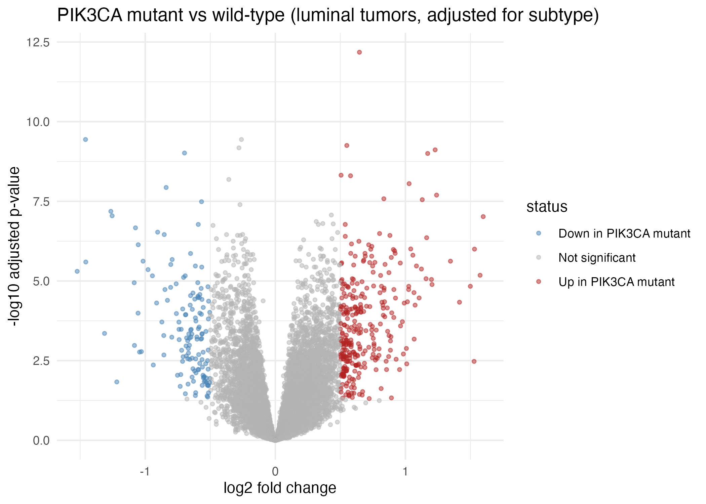
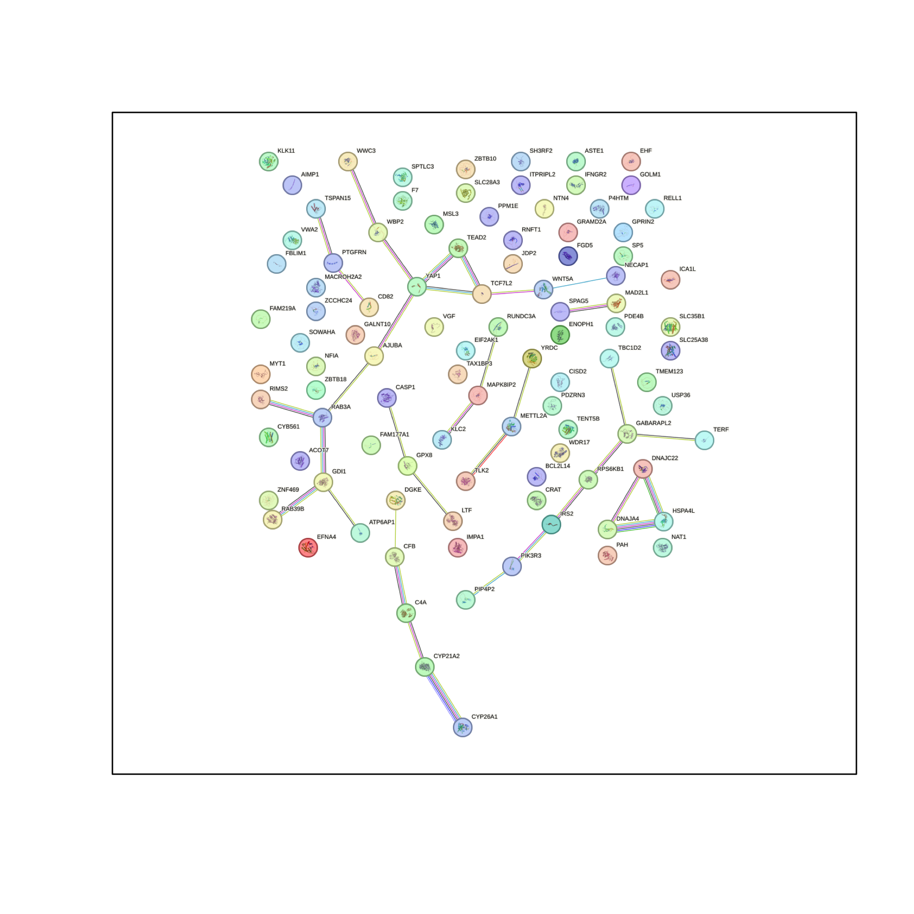
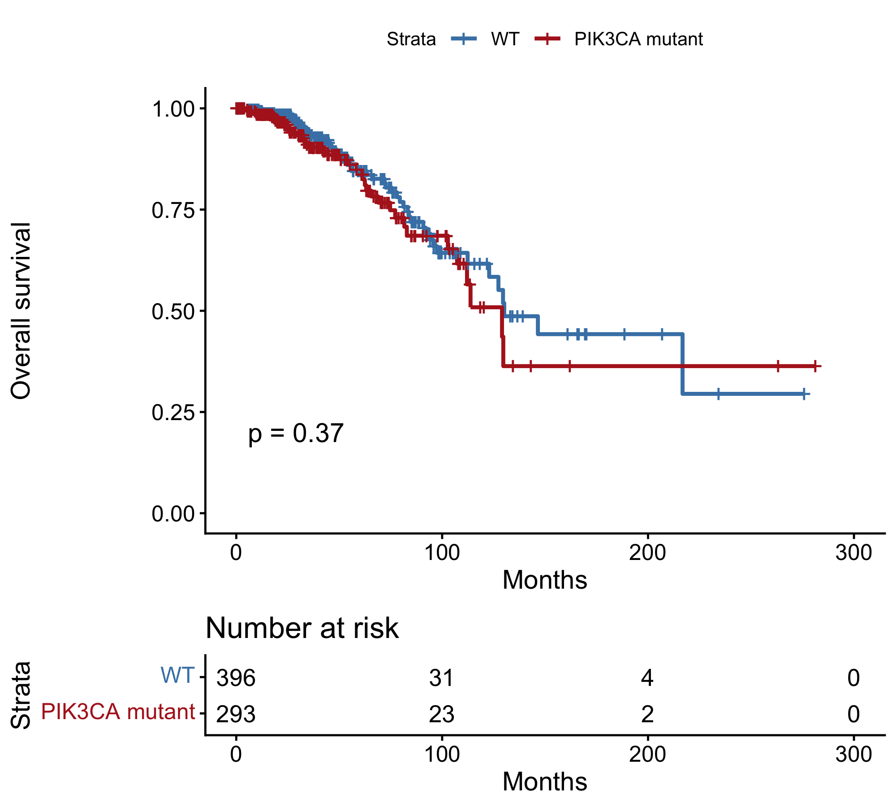

# PIK3CA mutation in luminal TCGA breast cancer

## Question
How does PIK3CA mutation status relate to gene expression and survival within luminal (LumA and LumB) breast tumors in TCGA?

## Data
TCGA-BRCA PanCancer Atlas (via cBioPortalData): somatic mutations, RNA-seq (RSEM), clinical data. STRING v12.0 for network and enrichment.

## Methods
- Restricted to luminal tumors (LumA + LumB) with mutation and expression data (696 tumors; 296 PIK3CA-mutant, 400 wild-type). PIK3CA-mutant = non-silent somatic mutation, top changes were the known hotspots H1047R, E545K and E542K.
- Differential expression with limma (log2 RSEM + 1), adjusting for luminal subtype. Significant: adjusted p < 0.05 and |log2FC| > 0.5.
- STRING network of the top 100 genes by adjusted p-value, enrichment of all significant genes, with all tested genes as background.
- Kaplan-Meier and Cox regression for overall survival (689 tumors, 88 deaths), adjusted for subtype.

## Results
- 311 genes higher and 138 lower in PIK3CA-mutant tumors. IRS2 (Insulin Receptor Substrate 2) was lower (log2FC -0.70), consistent with known PI3K feedback on insulin/IGF signaling because in luminal breast cancers with activating PIK3CA mutations, PI3K signaling is chronically turned on, which triggers an internal negative feedback loop that tells the cell to dial back upstream receptors like IRS2.
- PIK3CA mRNA itself was unchanged (log2FC 0.05), as expected for hotspot mutations that alter activity rather than expression.
- Enrichment was dominated by broad extracellular and secreted-protein terms, with weaker neuronal-system and ion-transport terms and no PI3K-specific pathway was detected.
- Survival: HR 1.45 (95% CI 0.93-2.26, p = 0.10) after subtype adjustment, no statistically significant association.

## Limitations
- PIK3CA status is based on somatic mutation calls only, all non-silent variants are grouped together.
- Up-regulated and down-regulated genes were pooled for enrichment.
- Many significant genes have small fold changes, the large sample size gives high statistical power.
- Only 88 deaths, so survival power is limited.
- Exploratory learning project, these results are hypotheses, not novel findings.

## Code development
AI-assisted programming tools were used to support code writing and troubleshooting. The author reviewed and refined the code and is responsible for the analytical workflow and biological interpretation.
